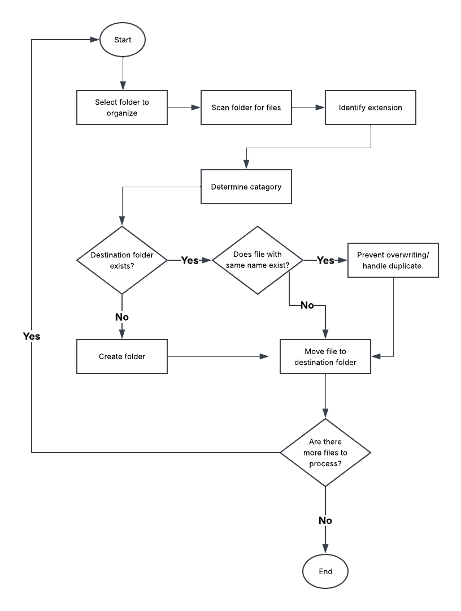
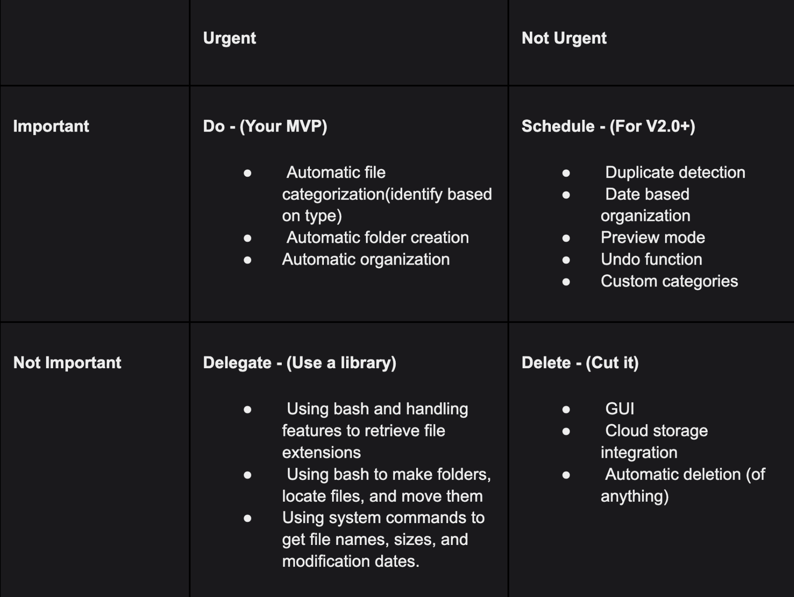

# Auto-File-Sorter

This is a smart file organizer that automatically sorts an organizes files in a selected folder. It will identify the files and move them into categorized folders. 

## The Problem
My downloads folder is always cluttered with documents, images, and files that are hard to find. It would be useful to have some tool that can  automatically sort those files into organized folders based on what type of file it is, and what dated it was created. This would reduce the amount of time I spend manually organizing the files and make the process more efficient.

## How it works

## Tech Stack
- **Language:** Bash 
- **Libraries:** None
- **External tools:** VS Code, Terminal

## Eisenhower Matrix

## Author

Anaya Singh, [GitHub Link:](https://github.com/nythespy)
